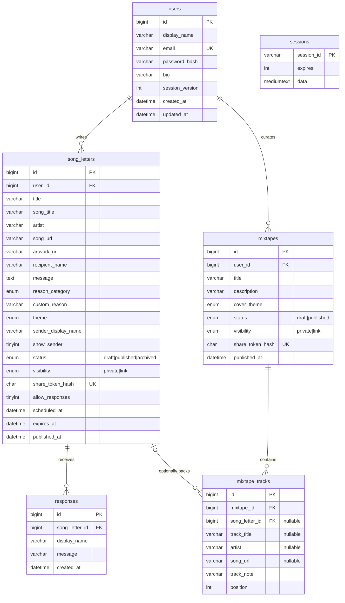

# Database

Database name: `dear_in_stereo_db`. Created by `database.sql` (MySQL 8.0.16+, InnoDB, utf8mb4). All timestamps are UTC.

## Design decisions

- **Deletion**: every foreign key is `ON DELETE CASCADE`. Deleting a user removes their letters, mixtapes, tracks and replies. Deleting a letter removes its replies and its entries in mixtapes.
- **Tracks**: a track is either a reference to one of the owner's letters (`song_letter_id`, song columns NULL) or a standalone song (`song_letter_id` NULL, song columns set). The database `CHECK` ensures the three standalone columns are all set or all empty. MySQL does not allow a `CHECK` on a column used by a cascading foreign key, so "exactly one kind" and "the letter belongs to the same owner" are enforced in `server/routes/mixtapes.js`.
- **Share tokens**: only `share_token_hash` (SHA-256, 64 hex characters, unique index) is stored. A NULL hash means no active link.
- **Mixtape publication**: `status = 'published'` exactly while a link is active. Revoking sets `draft`.
- **Positions** are 1..n per mixtape, renumbered in the same transaction that removes or reorders a track.
- **Indexes**: `(user_id, status, updated_at)` and `(user_id, created_at)` on letters, `(user_id, updated_at)` on mixtapes, `(mixtape_id, position)` on tracks, `(song_letter_id, created_at)` on responses, unique indexes on email and tokens.
- **`session_version`**: bumping it invalidates every existing session of that user.
